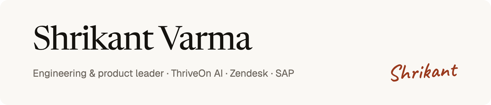
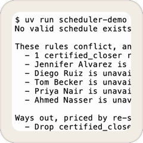
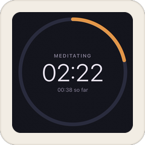
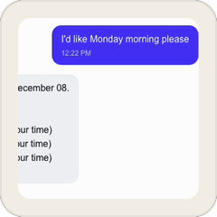

<picture>
  <source media="(prefers-color-scheme: dark)" srcset="assets/header-dark.png">
  
</picture>

Hi, I'm Shrikant.

I've led product and engineering teams at Zendesk and SAP. Today I run ThriveOn AI, where I build AI products and help companies ship theirs. I thrive at the intersection of technology, business, and human behavior—spotting unmet needs, identifying opportunities, and building solutions that deliver meaningful, measurable value.

**Products** · demos, architecture and results

<a href="https://github.com/shrikantvarma/ai-shift-scheduler"><picture><source media="(prefers-color-scheme: dark)" srcset="assets/ass-dark.png"></picture></a>

**[AI Shift Scheduler](https://github.com/shrikantvarma/ai-shift-scheduler)** Staff schedules from plain English that cannot break a labour rule. Workforce ops · LLM + optimisation
 

<a href="https://github.com/shrikantvarma/gentle-meditation-timer"><picture><source media="(prefers-color-scheme: dark)" srcset="assets/gmt-dark.png"></picture></a>

**[Gentle Meditation Timer](https://github.com/shrikantvarma/gentle-meditation-timer)** A meditation app where a missed day never costs you your progress. [Try it on the App Store →](https://apps.apple.com/app/id6823328743) Consumer health · iOS app
 

<a href="https://github.com/shrikantvarma/ai-meeting-scheduler"><picture><source media="(prefers-color-scheme: dark)" srcset="assets/ams-dark.png"></picture></a>

**[AI Meeting Scheduler](https://github.com/shrikantvarma/ai-meeting-scheduler)** Book a meeting through a short chat, without showing anyone your calendar. Sales & scheduling · AI agent
 

<a href="https://github.com/shrikantvarma/ai-restaurant-posts"><picture><source media="(prefers-color-scheme: dark)" srcset="assets/arp-dark.png"></picture></a>

**[AI Restaurant Posts](https://github.com/shrikantvarma/ai-restaurant-posts)** A dish photo becomes an Instagram post, no copywriter needed. Small-business marketing · Mobile app
 

<a href="https://github.com/shrikantvarma/customer-communication-assistant"><picture><source media="(prefers-color-scheme: dark)" srcset="assets/cca-dark.png"></picture></a>

**[Customer Communication Assistant](https://github.com/shrikantvarma/customer-communication-assistant)** Drafts every customer reply in your business's voice. You approve; it never sends. Customer support · AI agent with human approval
 

**Open source**

- [**hop**](https://github.com/shrikantvarma/hop): bookmark and jump between folders in zsh, with fuzzy search.
- [**claude-session-browser**](https://github.com/shrikantvarma/claude-session-browser): browse and search your past Claude Code sessions in a local web UI.
- [**zero-friction-vault**](https://github.com/shrikantvarma/zero-friction-vault): an Obsidian setup for capturing, processing and keeping what you read.

**Elsewhere**

[shrikantvarma.com](https://shrikantvarma.com) · [Articles on Substack](https://shrikantvarma.substack.com) · [LinkedIn](https://www.linkedin.com/in/shrikantvarma/)
